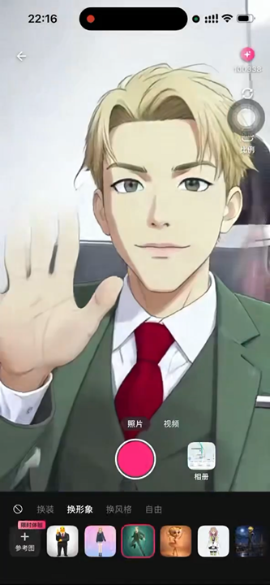
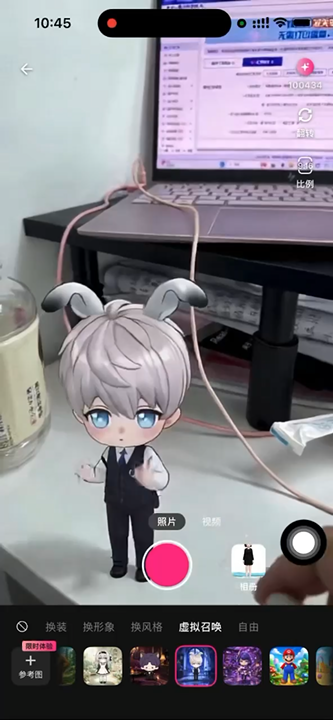

<p align="center">
  
</p>

<p align="center">
  <a href="https://developer.mozilla.org/en-US/docs/Web/JavaScript"></a>
  <a href="https://platform.xmaxai.com/"></a>
  <a href="./LICENSE"></a>
</p>

We introduce XmaxSDK, a JavaScript SDK designed for real-time interactive video generation via Xmax models. XmaxSDK implements an end-to-end pipeline covering media acquisition, video streaming, frame-by-frame generation, and on-device rendering, enabling developers to seamlessly integrate low-latency, high-fidelity video transformations into creative applications at a much lower cost than alternative solutions.

<p align="center"></p>

<br>

## What you can build with XmaxSDK

<table>
  <tr>
    <th width="24%" align="left">Realtime Use Case</th>
    <th width="60%" align="left">Description</th>
    <th width="16%" align="center">Demo</th>
  </tr>
  <tr>
    <td rowspan="2" width="24%" valign="middle">
      <strong>Character Swapping</strong>
    </td>
    <td width="60%" valign="middle">
      Replace anyone in your live feed with a designated avatar in real-time.
    </td>
    <td rowspan="2" width="16%" align="center" valign="middle">
      <a href="./materials/videos/use-cases/character-swapping.mp4">
        
        <br>
        <sub>▶ Play demo</sub>
      </a>
    </td>
  </tr>
  <tr>
    <td width="60%" valign="middle">
      <strong>Prompt:</strong> <code>视频中角色替换成参考图中角色</code>
      <br><br>
      <strong>Reference image:</strong> Select a clear image of the desired character with a clean background.
    </td>
  </tr>
  <tr>
    <td rowspan="2" width="24%" valign="middle">
      <strong>Virtual Try-On</strong>
    </td>
    <td width="60%" valign="middle">
      Seamlessly change outfits, preserving exact body shape, natural motion, and an
      authentic fit.
    </td>
    <td rowspan="2" width="16%" align="center" valign="middle">
      <a href="./materials/videos/use-cases/virtual-try-on.mp4">
        
        <br>
        <sub>▶ Play demo</sub>
      </a>
    </td>
  </tr>
  <tr>
    <td width="60%" valign="middle">
      <strong>Prompt:</strong> <code>视频中人物衣服替换成参考图中衣服</code>
      <br><br>
      <strong>Reference image:</strong> Select a clear image of the target outfit with a clean background.
    </td>
  </tr>
  <tr>
    <td rowspan="2" width="24%" valign="middle">
      <strong>Video Restyling</strong>
    </td>
    <td width="60%" valign="middle">
      Reimagine your world in any style with an immersive visual experience.
    </td>
    <td rowspan="2" width="16%" align="center" valign="middle">
      <a href="./materials/videos/use-cases/video-restyling.mp4">
        
        <br>
        <sub>▶ Play demo</sub>
      </a>
    </td>
  </tr>
  <tr>
    <td width="60%" valign="middle">
      <strong>Prompt:</strong> <code>视频风格变为参考图指定的风格</code>
      <br><br>
      <strong>Reference image:</strong> Select an image that captures the artistic style you want to apply.
    </td>
  </tr>
  <tr>
    <td rowspan="2" width="24%" valign="middle">
      <strong>AI Companions</strong>
    </td>
    <td width="60%" valign="middle">
      Summon virtual characters into your live camera feed and interact with them
      through gestures.
    </td>
    <td rowspan="2" width="16%" align="center" valign="middle">
      <a href="./materials/videos/use-cases/ai-companions.mp4">
        
        <br>
        <sub>▶ Play demo</sub>
      </a>
    </td>
  </tr>
  <tr>
    <td width="60%" valign="middle">
      <strong>Prompt:</strong> <code>指定角色在场景中互动</code>
      <br><br>
      <strong>Reference image:</strong> Select a clear image of the virtual character you want to summon with a clean background.
    </td>
  </tr>
  <tr>
    <td rowspan="2" width="24%" valign="middle">
      <strong>Live Photo</strong>
    </td>
    <td width="60%" valign="middle">
      Animate and control characters in your images simply by drawing motion
      trajectories.
    </td>
    <td rowspan="2" width="16%" align="center" valign="middle">
      <a href="./materials/videos/use-cases/live-photo.mp4">
        
        <br>
        <sub>▶ Play demo</sub>
      </a>
    </td>
  </tr>
  <tr>
    <td width="60%" valign="middle">
      <strong>Prompt:</strong> <code>让画面自然动起来</code>
      <br><br>
      <strong>Reference image:</strong> Use the input image as the reference
    </td>
  </tr>
</table>

<br>

## Why XmaxSDK?

<table>
  <thead>
    <tr>
      <th height="104" align="center" valign="middle">
        <br>Low latency
      </th>
      <th height="104" align="center" valign="middle">
        <br>Cost efficiency
      </th>
      <th height="104" align="center" valign="middle">
        <br>High fidelity
      </th>
    </tr>
  </thead>
  <tbody>
    <tr>
      <td>End-to-end latency is measured in , ensuring that updates to generation conditions and interaction controls are reflected instantly.</td>
      <td>Run on a , reducing inference costs by orders of magnitude versus datacenter GPUs like H100.</td>
      <td>Our models support real-time generation at up to , delivering production-ready, high-quality video output.</td>
    </tr>
  </tbody>
</table>

<br>

## Prerequisites

- A WebRTC-enabled browser running on HTTPS or localhost
- Node.js 18 or later, with pnpm or npm for development
- An Xmax API key

> [!WARNING]
> Never commit your Xmax API key to version control or embed a long-lived key in
> client-side bundles. Use short-lived temporary keys issued by your backend
> through the Xmax API. For step-by-step
> instructions, see [Authentication](https://platform.xmaxai.com/docs/authentication).

<br>

## Installation

```bash
npm install @xmaxai/web-sdk
```

The package includes optional React components at `@xmaxai/web-sdk/react`.
React applications use their own React installation; non-React applications do not need React.

For HTML pages without a build tool, see the [browser distribution](materials/browser.md).

<br>

## Quick Start

Create a camera stream, start realtime generation, and display the result:

```javascript
import {
  CameraPosition, RealtimeConfiguration, RealtimeContext, RealtimeModel,
  RealtimeCameraPreset, XmaxClient, XmaxConfiguration, XmaxEnvironment,
  XmaxRealtimeDualVideoView,
} from '@xmaxai/web-sdk'

// Initialize the client
const client = new XmaxClient(new XmaxConfiguration({
  apiKey: '<YOUR_XMAX_API_KEY>',
  environment: XmaxEnvironment.global,
}))

// Initialize the realtime manager
const realtime = client.createRealtimeManager(
  new RealtimeConfiguration({ model: RealtimeModel.x2_1 })
)

// Create the video view
const videoView = new XmaxRealtimeDualVideoView()
videoView.attach(container) // container is a sized element on your page

// Create a camera stream and bind the preview
const localStream = await realtime.createLocalCameraStream({
  preset: RealtimeCameraPreset.resolution1920x1080,
  position: CameraPosition.front,
  useMicrophone: false,
})
videoView.localTrack = localStream.videoTrack

// Once the preview is ready, start generation and display the result
const remoteStream = await realtime.startGeneration({
  localStream,
  context: new RealtimeContext({
    prompt: "视频中角色替换成参考图中角色",
    referencePath: "https://cdn.22duck.cn/images/source/charx/charx_real_image7.png?presetVersion=20260909",
  }),
})
videoView.remoteTrack = remoteStream.videoTrack

// Run the following when generation is no longer needed
await realtime.close()
```

<br>

## Example Project

A complete React application is available in
[`examples/xlab-react`](./examples/xlab-react). It demonstrates camera, image and
video inputs, reference images, touch interaction, statistics, and recording.

<br>

## Dependencies

- <ins><strong>Tencent Cloud TRTC SDK for Web</strong></ins> enables low-latency, real-time audio and video communication.
- <ins><strong>Agora RTC SDK for Web</strong></ins> provides an alternative RTC transport for the Agora model.
- <ins><strong>Volcengine VeRTC SDK for Web</strong></ins> enables real-time audio and video communication.
- <ins><strong>Tencent Cloud COS SDK</strong></ins> handles media upload and download via object storage.

<br>

## Contact us

For bug reports and feature requests, please open a
[GitHub Issue](https://github.com/Xmax-AI/XmaxSDK-Web/issues). For integration
assistance and technical support, contact us at [sdk@xmax.ai](mailto:sdk@xmax.ai).

<br>

## License

XmaxSDK Web is available under the terms of the [MIT License](./LICENSE).
Third-party dependencies retain their respective licenses.
